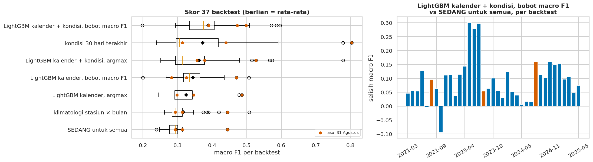
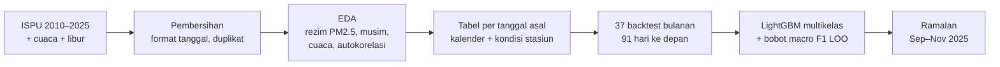
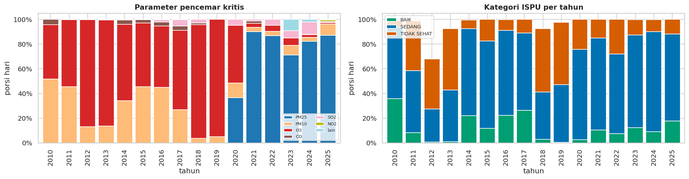
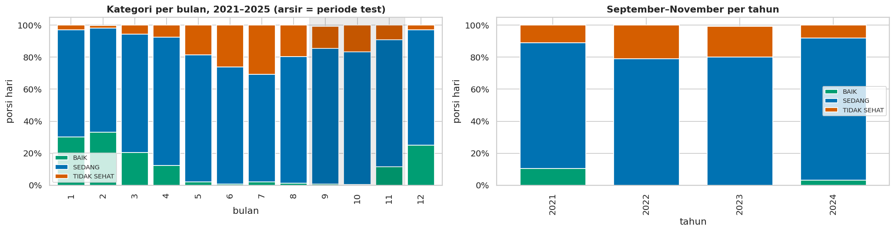
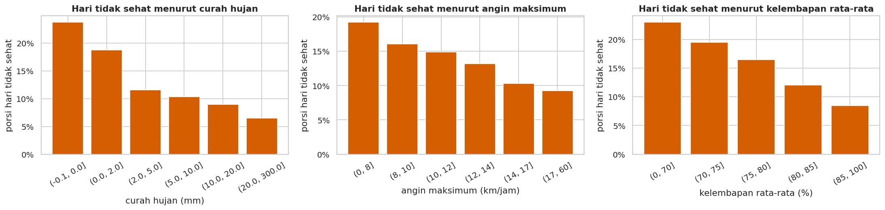
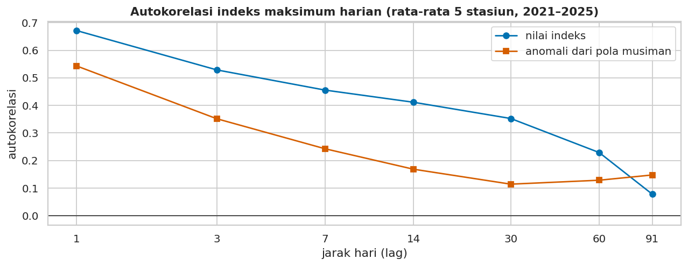
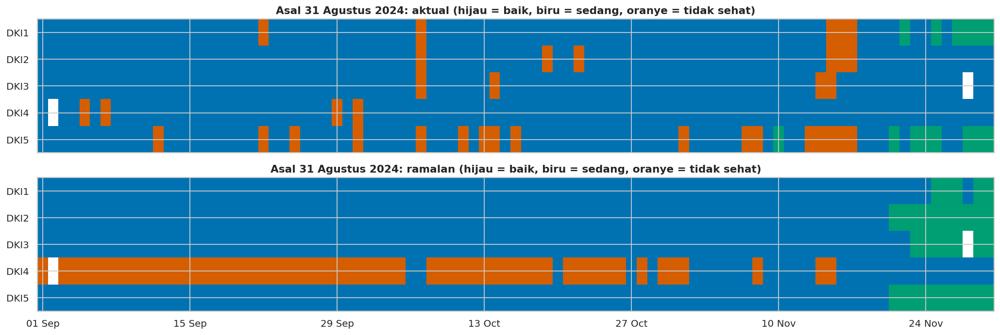
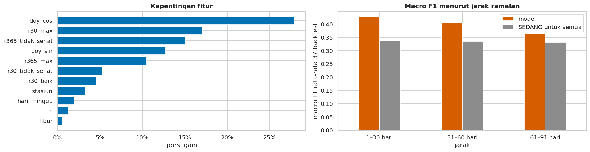
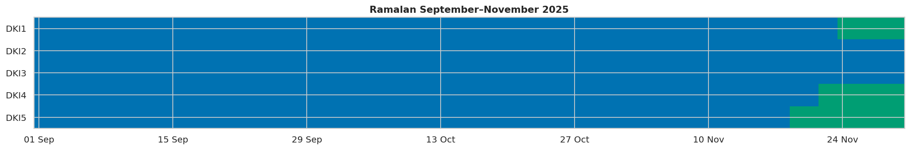

<p align="center">
  
  <br><sub>Gambar: halaman kompetisi <a href="https://www.kaggle.com/competitions/penyisihan-datavidia-10">Air Pollution Prediction, Penyisihan Datavidia 10</a> di Kaggle.</sub>
</p>

# Meramal Kategori Kualitas Udara Jakarta Tiga Bulan ke Depan
### Datavidia 10 (Arkavidia ITB) · Klasifikasi ISPU harian 5 stasiun DKI Jakarta, metrik macro F1

**Data ISPU dan cuaca berakhir 31 Agustus 2025. Seberapa baik kategori kualitas udara bisa diramal untuk 1–91 hari ke
depan, dan informasi apa yang masih berguna sejauh itu?**

Kompetisi ini meminta kategori ISPU (BAIK, SEDANG, TIDAK SEHAT) untuk setiap stasiun dan hari antara 1 September dan
30 November 2025. Analisis disusun seperti laporan riset: setiap keputusan pemodelan berasal dari temuan EDA, dan setiap
temuan dibuktikan dengan grafik.

**Temuan utama: pada September–November, 79–89% hari berkategori SEDANG, sehingga kelas mayoritas sudah memberi macro F1
0,295. Dari 37 backtest bulanan, LightGBM dengan fitur kalender, kondisi stasiun terakhir, dan bobot keputusan untuk macro
F1 mencapai 0,389 ± 0,083. Keunggulannya paling besar di 30 hari pertama dan menyusut seiring jarak ramalan.**



---

## Ruang lingkup

- Pembersihan 16 file ISPU dengan format yang bercampur, pergantian parameter kritis ke PM2.5, pola musim, pengaruh
  cuaca, dan autokorelasi indeks.
- Baseline kelas mayoritas, klimatologi, dan kondisi 30 hari terakhir.
- LightGBM multikelas dengan fitur kalender dan kondisi stasiun pada tanggal asal, serta bobot keputusan untuk macro F1
  yang dipilih leave-one-backtest-out.
- Kepentingan fitur dan skor menurut jarak ramalan.

Notebook asli dari masa kompetisi (Februari 2026) hilang. Seluruh analisis di repositori ini disusun ulang dari nol pada
November 2026 dan dijalankan penuh di Kaggle.

## Data dan desain eksperimen

| Data | Isi | Baris |
| --- | --- | ---: |
| `ISPU/` (16 file, 2010–2025) | indeks harian per parameter, parameter kritis, kategori | 15.194 hari-stasiun valid |
| `cuaca-harian/` | hujan, angin, kelembapan, suhu per stasiun, sampai 31 Agustus 2025 | |
| `libur-nasional/`, `NDVI/` | hari libur dan indeks vegetasi | |
| `sample_submission.csv` | 5 stasiun × 91 hari | 455 |

Backtest meniru situasi kompetisi dari setiap akhir bulan antara Maret 2021 dan Mei 2025 (37 tanggal asal): model hanya
dilatih dengan data yang targetnya sudah lewat sebelum tanggal asal, lalu meramal 91 hari sekaligus. Satu backtest hanya
berisi sekitar 450 baris dan kelas jarang bisa muncul 0–196 kali, jadi yang dilaporkan adalah rata-rata dari semua backtest.



## Cerita dari data

### 1. PM2.5 mengubah skala sejak 2021



Sampai 2019 parameter kritis didominasi O3 dan PM10. Sejak 2021 PM2.5 menjadi parameter kritis di 70–90% hari, dan
proporsi kategori jauh lebih stabil. Hanya periode 2021–2025 yang dipakai untuk menilai model.

### 2. Periode test adalah musim peralihan



Pada September–November 2021–2024, SEDANG 79–89%, TIDAK SEHAT 8–21%, dan BAIK hanya muncul pada 2021 (10%) dan 2024 (3%).
Kelas BAIK sangat jarang di periode ini, padahal macro F1 memberinya bobot sepertiga.

### 3. Cuaca menjelaskan hari buruk, tetapi berhenti di 31 Agustus



Hari tanpa hujan 24% TIDAK SEHAT, hari dengan hujan di atas 20 mm hanya 6%. Angin dan kelembapan bekerja ke arah yang sama.
Namun data cuaca berhenti bersamaan dengan ISPU, sehingga tidak bisa dipakai sebagai fitur untuk periode test.

### 4. Kondisi hari ini cepat memudar



Korelasi anomali musiman dengan hari kemarin 0,54, turun ke 0,24 setelah seminggu dan sekitar 0,1 setelah sebulan. Kondisi
akhir Agustus hanya membantu di minggu-minggu awal.

## Hasil

### Perbandingan model (macro F1, 37 backtest bulanan)

| Model | Rata-rata | Std | 3 backtest asal 31 Agustus |
| --- | ---: | ---: | ---: |
| SEDANG untuk semua hari | 0,295 | 0,040 | 0,351 |
| Klimatologi stasiun × bulan | 0,317 | 0,058 | 0,351 |
| LightGBM kalender, argmax | 0,325 | 0,052 | 0,377 |
| LightGBM kalender, bobot macro F1 | 0,344 | 0,058 | 0,359 |
| LightGBM kalender + kondisi, argmax | 0,363 | 0,111 | 0,420 |
| Kondisi 30 hari terakhir | 0,373 | 0,137 | 0,519 |
| **LightGBM kalender + kondisi, bobot macro F1 (akhir)** | **0,389** | 0,083 | 0,454 |

Bobot keputusan (BAIK 3, SEDANG 1, TIDAK SEHAT 2) dipilih leave-one-backtest-out, sehingga skor tiap backtest dinilai dengan
bobot yang tidak pernah melihat backtest itu. Baseline 30 hari terakhir unggul di tiga backtest Agustus, tetapi simpangannya
paling besar: ia gagal ketika musim berganti.

### Ramalan vs kenyataan di backtest 31 Agustus 2024



Model menangkap pergantian ke BAIK di akhir November (11 dari 14 hari BAIK tertebak, macro F1 0,472), tetapi hampir tidak
menangkap hari TIDAK SEHAT, yang muncul sebagai lonjakan singkat yang digerakkan cuaca harian.

### Skor kompetisi

| Submission | Public | Private |
| --- | ---: | ---: |
| Notebook ini (late submission, tidak masuk leaderboard resmi) | 0,292 | 0,329 |
| Submission tim dengan private tertinggi, Februari 2026 (peringkat akhir 59 dari 205) | 0,914 | 0,956 |
| Peringkat 1 leaderboard private | | 0,977 |

Skor late submission setara dengan skor backtest. Skor di atas 0,9 jauh melampaui apa yang dicapai peramalan dari data
sampai Agustus 2025 di backtest (rata-rata 0,39 ± 0,08), sehingga kemungkinan besar memanfaatkan informasi tentang
kondisi aktual September–November 2025, misalnya data ISPU yang dipublikasikan kemudian. Notebook ini sengaja hanya
memakai data yang diberikan panitia.

## Interpretasi



Fitur terpenting adalah posisi dalam tahun (41% gain) dan tingkat polusi stasiun dalam 30 dan 365 hari terakhir. Model
bekerja sebagai klimatologi yang disesuaikan dengan kondisi terakhir stasiun. Keunggulannya atas kelas mayoritas 0,43 vs 0,34
di 30 hari pertama dan menyusut menjadi 0,36 vs 0,33 di hari 61–91.



Ramalan akhir 93,8% SEDANG dan 6,2% BAIK, dengan BAIK di akhir November di DKI1, DKI4, dan DKI5.

## Menjalankan

Notebook dijalankan di Kaggle (CPU, sekitar 6 menit).

```bash
pip install -r requirements.txt kaggle
python _build_notebook.py                  # regenerasi notebook + runner dari satu sumber
kaggle kernels push -p kaggle-notebook     # notebook yang tampil di Kaggle
kaggle kernels push -p kaggle              # runner: mengeksekusi notebook dan menyimpan versi ber-output
kaggle kernels output fauzan2/datavidia-10-air-quality-forecast-runner -p output/
```

Data kompetisi tidak disertakan di repositori. Unduh dari halaman kompetisi ke `data/raw/` (berisi folder `ISPU/`,
`cuaca-harian/`, `libur-nasional/`, `NDVI (vegetation index)/`, dan `sample_submission.csv`), lalu jalankan notebook dari
folder `notebooks/`.

## Peta repositori

| Lokasi | Isi |
| --- | --- |
| `notebooks/datavidia-10-air-quality-forecast.ipynb` | Notebook riset lengkap dengan output |
| `src/data/load_data.py` | Pembersihan dan penggabungan file ISPU, cuaca, dan libur |
| `src/features/build_features.py` | Tabel per tanggal asal: fitur kalender, kondisi stasiun, dan jarak ramalan |
| `src/models/forecast.py` | LightGBM multikelas, macro F1, dan pemilihan bobot keputusan |
| `src/visualization/plots.py` | Gaya grafik dan palet ramah buta warna (Okabe–Ito) |
| `reports/figures/` | 9 grafik yang dipakai di notebook dan README |
| `reports/backtest_results.csv` | Skor setiap model di setiap backtest |
| `submissions/submission.csv` | Submission akhir |
| `_build_notebook.py`, `_findings.json` | Sumber tunggal notebook dan runner Kaggle, beserta teks temuan |
| `kaggle-notebook/`, `kaggle/` | Metadata kernel notebook dan runner |

## Keterbatasan

Periode test hanya 455 baris, sehingga skor sangat bergantung pada beberapa hari kelas jarang. Backtest 2021–2025 hanya
mencakup empat musim September–November. Tanpa cuaca untuk periode ramalan, lonjakan hari TIDAK SEHAT praktis tidak bisa
diramal. Skor late submission diperoleh setelah kompetisi berakhir dan tidak dapat dibandingkan secara setara dengan
peserta yang bekerja dalam batas waktu kompetisi.

## Penulis

**Fauzan Ahsanudin Alfikri** · [Kaggle: fauzan2](https://www.kaggle.com/fauzan2)

Data berasal dari kompetisi [Air Pollution Prediction, Penyisihan Datavidia 10](https://www.kaggle.com/competitions/penyisihan-datavidia-10)
(Arkavidia ITB) dan hanya digunakan untuk keperluan edukasi dan portofolio.
